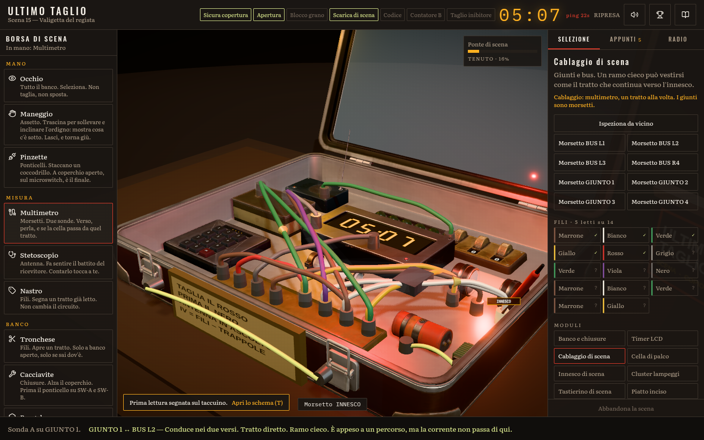
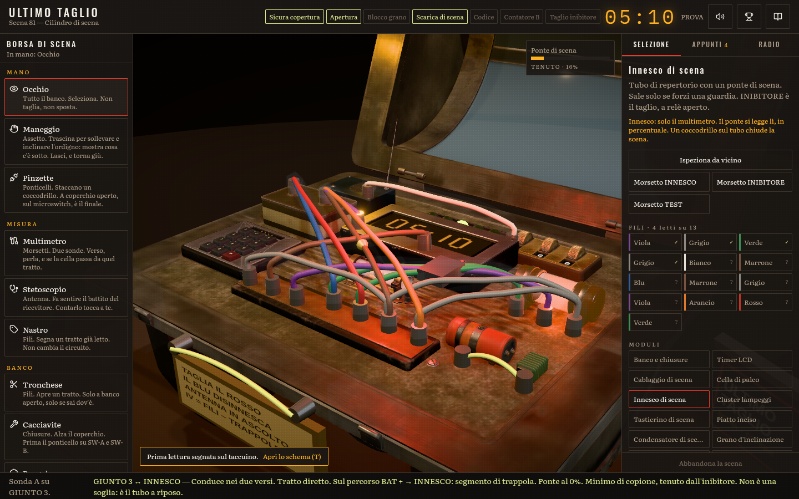
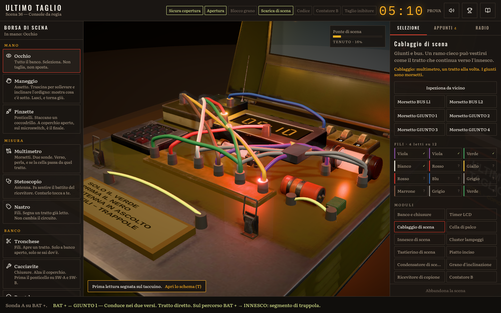
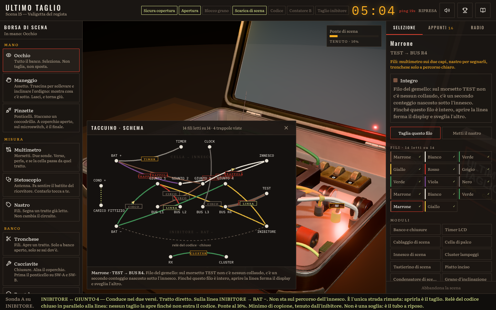
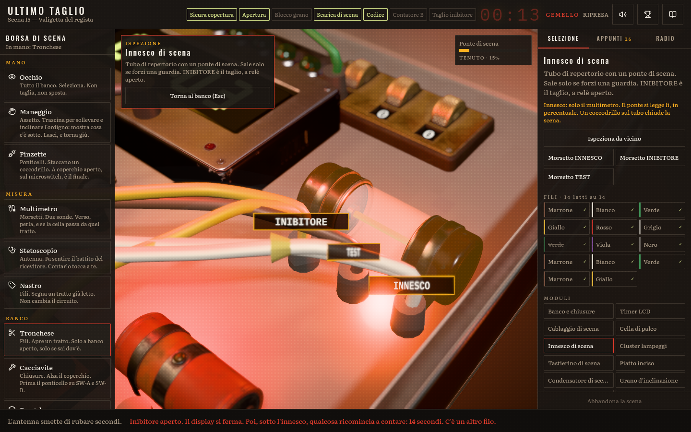
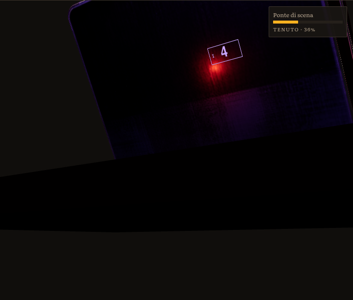
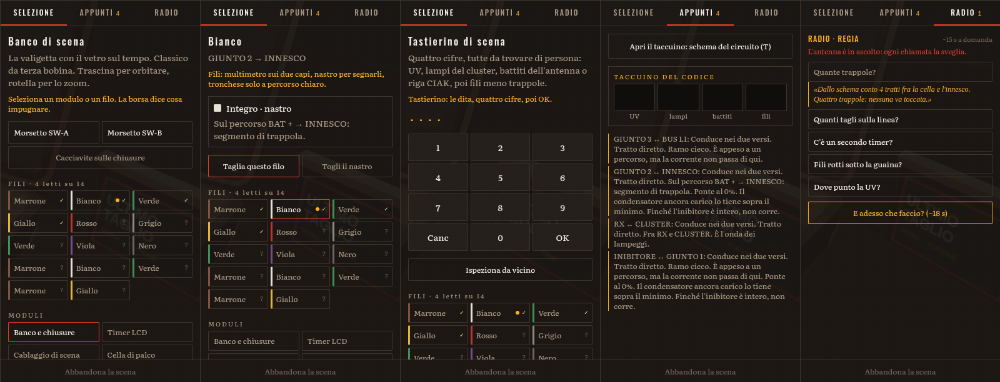
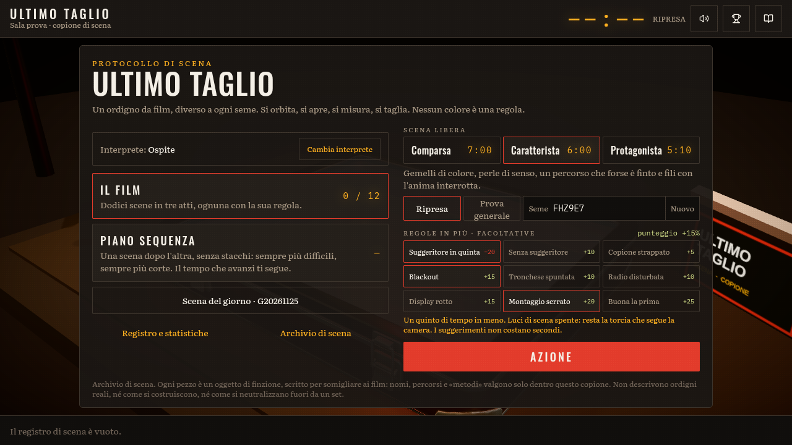
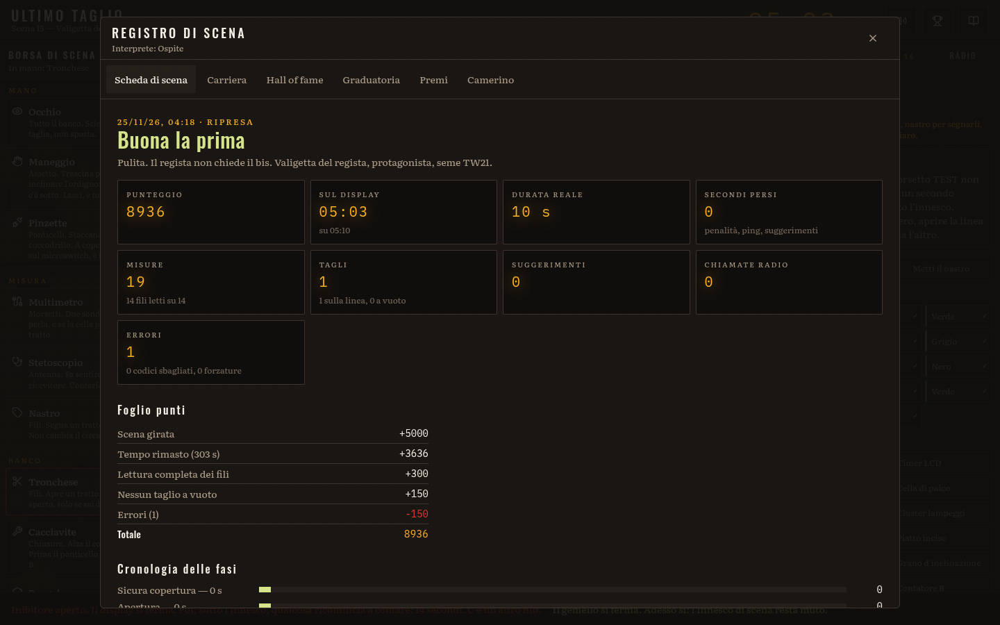

# ULTIMO TAGLIO

**Simulatore di disinnesco di un ordigno di scena, da film.** Un attrezzo di repertorio
sul banco, un display che scende, una borsa di strumenti e nessun colore che voglia dire
qualcosa: il filo giusto si trova misurando, non indovinando.

Ogni seme genera un ordigno diverso. Si orbita, si apre, si ispeziona, si misura, si
taglia. Tutto quello che serve a decidere è sul banco e si può indagare; niente è scritto
sull'isolante.

**Online: <https://timrouter.dns.army/ultimo-taglio/>**



> È un gioco, un tributo ai cliché del cinema: il filo rosso e il filo blu, il timer che
> si ferma a un secondo, il complice alla radio, il falso finale. Ogni pezzo è un oggetto
> di finzione: nomi, percorsi e «metodi» valgono solo dentro questo copione. Non descrive
> ordigni reali, né come si costruiscono, né come si neutralizzano fuori da un set.

## Come si gioca

1. **Si mette in sicura la copertura.** Due coccodrilli sul microswitch, poi il cacciavite
   sulle chiusure. Al contrario, il contatto chiude e la scena finisce lì.
2. **Si indaga.** Ogni modulo si ispeziona da vicino; la lampada UV fa brillare una cifra
   dipinta da qualche parte sul guscio, il cluster lampeggia la seconda, l'antenna batte
   la terza allo stetoscopio, la quarta si ricava contando i fili.
3. **Si misura.** Il multimetro legge il verso e il percorso di ogni tratto: cella,
   giunti, perle di senso, relè. Il taccuino disegna lo schema man mano che lo scopri.
4. **Si taglia.** Un filo sta sul percorso dalla cella all'innesco, ed è una trappola.
   Uno tiene chiusa la linea dell'inibitore, ed è quello giusto. A volte la linea si
   sdoppia e di tagli ne servono due.

## Che cosa c'è dentro

- **Ordigni generati dal seme**: tre carrozzerie (valigetta, cilindro, console), fino a
  14 fili su due reti disgiunte, giunti, rami ciechi, ritorni morti, perle di senso e
  fili con l'anima interrotta sotto la guaina, che solo il multimetro smaschera.
- **Un simulatore di circuito vero**, piccolo ma coerente: i ruoli dei fili non sono
  etichette ma conseguenze del grafo. I test verificano che ogni scena sia risolvibile e
  che multimetro, taccuino e logica raccontino la stessa storia.
- **Undici attrezzi tenuti in mano**, modellati in 3D: occhio, maneggio, pinzette,
  multimetro, stetoscopio, nastro, tronchese, cacciavite, brugola, coccodrilli, pila di
  servizio. La mano trema sotto i venti secondi.
- **I cliché, come meccaniche**:
  - il **filo del quarzo**: tagliarlo non ferma il timer, lo fa correre al doppio;
  - il **secondo timer nascosto**: apri la linea, il display si ferma, e sotto l'innesco
    parte un altro conteggio, corto. Lo ferma solo il filo del morsetto TEST;
  - il **complice alla radio**, con lo schema davanti: dice quante trappole ci sono, mai
    quale filo. Ma una trasmissione vicino a un'antenna in ascolto la sveglia;
  - la **cifra sotto la base**: la camera non ci arriva, bisogna sollevare l'ordigno con
    la mano. E prima va bloccato il grano d'inclinazione;
  - il piatto inciso con le sue bugie («TAGLIA IL ROSSO»).
- **Tre modi di giocare**:
  - **Il film**: dodici scene in tre atti, ognuna con la sua regola e il regista che
    commenta;
  - **Piano sequenza**: una scena dopo l'altra senza stacchi, sempre più difficili e più
    corte; un terzo del tempo che avanzi ti segue nella successiva;
  - **Scena libera**: tre parti (comparsa, caratterista, protagonista), prova generale
    senza orologio, scena del giorno uguale per tutti, e nove regole facoltative che
    ritoccano il punteggio (blackout, display rotto, tronchese spuntata…).
- **Registro e statistiche**: scheda di ogni scena con punteggio riga per riga e voto
  della critica, carriera, hall of fame, graduatoria fra interpreti, sedici premi.
  Profili liberi, senza password, esportabili e importabili come codice di testo. Tutto
  resta nel browser.
- **Cinema**: ciak d'apertura, letterbox, colonna sonora di tensione generata al volo,
  profondità di campo e bagliore, esplosione e luce verde di sollievo.

## Galleria

| | |
|---|---|
|  |  |
| Il **cilindro**: una capsula nella sua culla. | La **console**: un mobile da regia con la cappa di vetro. |
|  |  |
| Il **taccuino**: lo schema si disegna man mano che misuri. | Il **falso finale**: display fermo, e il gemello che conta. |
|  |  |
| La cifra **sotto la base**, visibile solo sollevando la valigetta alla luce UV. | La **scheda**: selezione, appunti e radio. |

**Sala prova**: film, piano sequenza, scena del giorno e scena libera con le regole a scelta.



**Titoli di coda**: la scheda di una scena, con punteggio e fasi.



## Avvio

Serve Node.js 22 o successivo.

```bash
npm install
npm run dev        # server di sviluppo
npm test           # 49 test: generazione, circuito, logica, bilanciamento, statistiche
npm run build      # controllo dei tipi + sito statico in dist/
```

Il build è un sito statico con base relativa: si serve da qualunque cartella. L'interfaccia
è in italiano ed è pensata **solo per PC**: mouse, tastiera e uno schermo largo.

### Comandi

| Tasto | Azione |
|---|---|
| Trascina / rotella | Orbita e zoom della camera |
| Doppio clic su un modulo | Ispezione ravvicinata (Esc per tornare) |
| `T` | Taccuino: schema del circuito |
| `U` `X` `E` | Lampada UV, raggi, vista esplosa |
| `F` `R` | Inquadra la selezione, camera a casa |
| `0`–`9` `Invio` `Backspace` | Tastierino |
| `Esc` | Archivio di scena (il copione) |

Con il **maneggio** in mano il tasto sinistro solleva e inclina l'ordigno, il destro
continua a muovere la camera.

## Struttura

| Percorso | Contenuto |
|---|---|
| `src/game/generate.ts` | Generazione dal seme: reti, giunti, esche, quarzo, gemello |
| `src/game/circuit.ts` | Simulatore: archi diretti, perle, relè, percorsi, classi dei fili |
| `src/game/logic.ts` | Riduttore puro del gioco: attrezzi, guardie, orologio, finali |
| `src/game/tuning.ts` | Durate e bilanciamento, con il tempo necessario stimato per passo |
| `src/game/campaign.ts` | Il film: dodici scene e le regole di scena |
| `src/game/sequence.ts` | Piano sequenza |
| `src/game/stats.ts`, `save.ts` | Scheda di scena, punteggio, premi, profili |
| `src/game/audio.ts` | Suoni, colonna di tensione e voce della radio (Web Audio) |
| `src/game/scene/` | Scena 3D: gusci, moduli, fili, attrezzi in mano, finale |
| `src/game/ui/` | Interfaccia: sala prova, scheda, taccuino, registro, film |
| `public/models/` | Modelli 3D in formato GLB |
| `deploy/` | Pubblicazione su un server Apache (script e configurazione) |

## Tecnologie

Vite 8, React 19, TypeScript, three.js con React Three Fiber e drei, postprocessing,
zustand, Tailwind 4, vitest. La logica è un riduttore puro senza dipendenze dalla scena:
i test la giocano per intero su centinaia di semi.

## Origine e crediti

- La prima versione è nata come prototipo in Grok App Builder; qui è stata riscritta in
  un progetto pulito e poi estesa (simulatore di circuito, modelli, attrezzi, campagna,
  statistiche, cliché).
- I modelli 3D di carrozzerie e moduli sono stati generati con
  [Thrixel](https://thrixel.com) da descrizioni testuali. Gli attrezzi sono procedurali.
- Caratteri: IBM Plex Mono, Literata e Oswald, da Google Fonts.
- Sviluppato con [Claude Code](https://claude.com/claude-code).

## Licenza

Il codice è software libero, distribuito con licenza
[GNU General Public License versione 3](LICENSE). Puoi usarlo, studiarlo, modificarlo e
ridistribuirlo alle stesse condizioni, senza alcuna garanzia.

## Limiti noti

- Pensato per il PC: su telefono non è né comodo né previsto.
- La voce del complice usa la sintesi vocale del browser e parla solo dove è installata
  una voce italiana; altrove restano il fruscio e il testo.
- Statistiche e profili vivono nel `localStorage` del browser: per portarli altrove si
  usa l'esportazione dal camerino.
